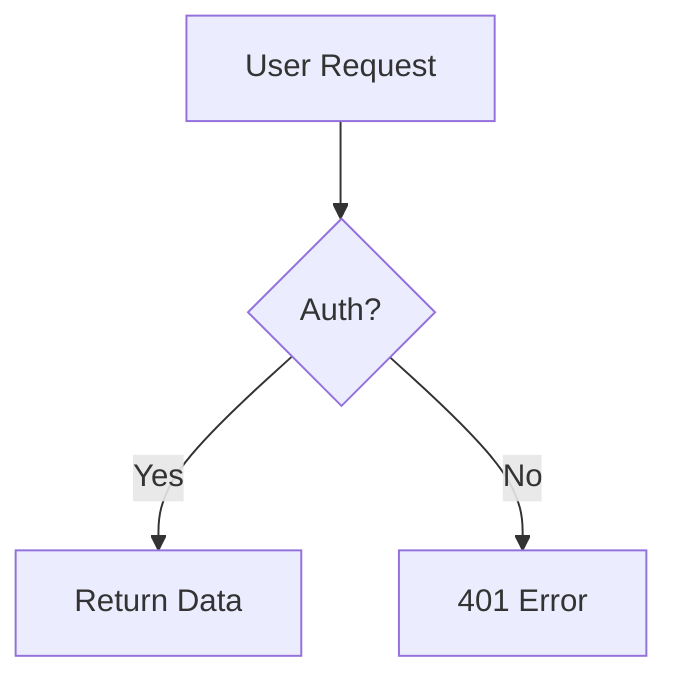

# PrepVault 📝

> A personal interview question bank — write in Markdown, render Mermaid diagrams, share topics publicly, works on mobile.

**Stack:** Pure HTML/CSS/JS · Supabase (auth + database) · GitHub Pages (hosting)  
**Cost:** $0 forever (Supabase free tier + GitHub Pages)

---

## Features

- ✅ Email & Google OAuth authentication
- ✅ Create unlimited topics (e.g. "React", "System Design", "SQL")
- ✅ Write questions & answers in **Markdown** with live preview
- ✅ **Mermaid diagrams** support (flowcharts, sequence diagrams, ERDs…)
- ✅ Make any topic **public** and share a read-only link
- ✅ Search across all your questions
- ✅ Dark / light / auto theme toggle
- ✅ Fully **mobile responsive**
- ✅ Deployed via GitHub Actions — push to `main` and it's live

---

## Setup Guide (15 minutes)

### Step 1 — Fork / clone this repo

```bash
git clone https://github.com/YOUR_USERNAME/prepvault.git
cd prepvault
```

Or click **Use this template** / **Fork** on GitHub.

---

### Step 2 — Create a free Supabase project

1. Go to [supabase.com](https://supabase.com) → **New project**
2. Choose a name, set a database password, pick the region closest to you
3. Wait ~2 minutes for provisioning

---

### Step 3 — Run the database schema

1. In your Supabase dashboard, go to **SQL Editor → New query**
2. Paste the entire contents of `supabase/schema.sql`
3. Click **Run** (green button)

You should see: *"Success. No rows returned"*

---

### Step 4 — Get your Supabase credentials

In your Supabase project dashboard:

1. Go to **Settings → API**
2. Copy:
   - **Project URL** (looks like `https://xxxx.supabase.co`)
   - **anon / public** key (long JWT string)

---

### Step 5 — Add secrets to GitHub

In your GitHub repo:

1. Go to **Settings → Secrets and variables → Actions → New repository secret**
2. Add:

| Secret name        | Value                        |
|--------------------|------------------------------|
| `SUPABASE_URL`     | Your project URL             |
| `SUPABASE_ANON_KEY`| Your anon key                |

---

### Step 6 — Enable GitHub Pages

1. Go to **Settings → Pages**
2. Under **Source**, select **GitHub Actions**
3. Save

---

### Step 7 — Deploy

Push any commit to `main` (or trigger manually via **Actions → Deploy PrepVault → Run workflow**).

After ~1 minute, your site is live at:
```
https://YOUR_USERNAME.github.io/prepvault/
```

---

### Step 8 (optional) — Enable Google OAuth

1. In Supabase: **Authentication → Providers → Google → Enable**
2. Follow the instructions to set up a Google Cloud OAuth client
3. Add your GitHub Pages URL to the **Allowed redirect URIs** in Google Cloud Console
4. Add the same URL to Supabase → **Authentication → URL Configuration → Redirect URLs**

---

### Step 9 (optional) — Custom domain

If you have a domain:
1. **Settings → Pages → Custom domain** in GitHub
2. Add a CNAME record pointing to `YOUR_USERNAME.github.io`
3. Update Supabase → **Authentication → URL Configuration** with your new domain

---

## Local development

No build step needed! Just open `docs/index.html` — but you'll need to temporarily hard-code your Supabase credentials for local testing.

Or use a simple local server:

```bash
cd docs
npx serve .
# or
python3 -m http.server 8080
```

Then visit `http://localhost:8080`.

For local dev, temporarily replace in `docs/index.html`:
```js
const SUPABASE_URL  = 'YOUR_SUPABASE_URL';   // → paste your actual URL
const SUPABASE_ANON = 'YOUR_SUPABASE_ANON_KEY'; // → paste your anon key
```

> ⚠️ Never commit real credentials. The GitHub Action injects them via secrets at deploy time.

---

## Mermaid diagram example

In the answer editor, use:

````

````

Supported diagram types: `graph`, `sequenceDiagram`, `erDiagram`, `classDiagram`, `gantt`, `pie`, `flowchart`, and more.

---

## Project structure

```
prepvault/
├── docs/
│   ├── index.html     ← Entire app (single file)
│   └── 404.html       ← GitHub Pages SPA redirect
├── supabase/
│   └── schema.sql     ← Database tables + RLS policies
├── .github/
│   └── workflows/
│       └── deploy.yml ← CI/CD pipeline
└── README.md
```

---

## Supabase free tier limits

| Resource       | Free limit         |
|----------------|--------------------|
| Database       | 500 MB             |
| Auth users     | Unlimited          |
| API requests   | 2 million / month  |
| Bandwidth      | 5 GB / month       |
| Storage        | 1 GB               |

More than enough for personal use. No credit card required.

---

## License

MIT — use it, fork it, customize it freely.
